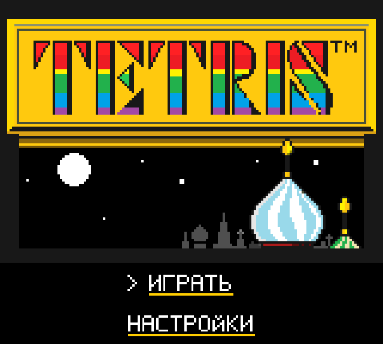
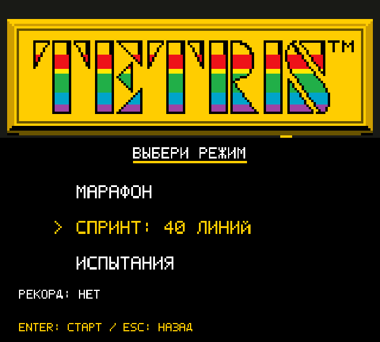
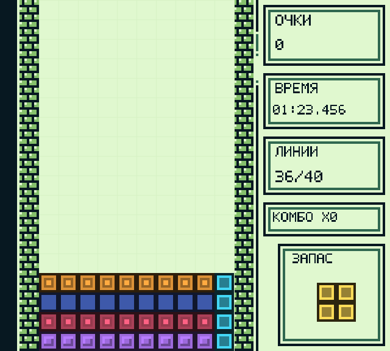

<div align="center">

# 🟩 Game Boy Tetris · Python

**Игра Цветной Тетрис. на Python и Pygame.**

Цветное меню с башнями, пиксельная кириллица, семь цветов фигур,<br>
спринт на 40 линий, испытания и комбо.




</div>

## Что это

Отдельная реализация игры на **Python / Pygame**. Игровая логика, интерфейс, ввод, отрисовка, звук и сохранения переписаны на Python. C#, MonoGame и .NET для запуска этой копии не нужны. Исходная версия на C# остаётся отдельным проектом.

Графика и аудио перенесены из [LordGurr/GameboyTetris](https://github.com/LordGurr/GameboyTetris). Цветное главное меню и новые режимы соответствуют доработанной русской версии.

## Возможности

| Режим | Задача |
| :--- | :--- |
| **Марафон** | Набирать очки; каждые 10 линий скорость увеличивается |
| **Спринт · 40 линий** | Очистить не менее 40 линий за минимальное время |
| **Испытания** | Очистить 10 линий, сделать тетрис или собрать комбо ×3 |

- Цветные фигуры включены по умолчанию; **F2** возвращает классические зелёные.
- Последовательные очищающие фигуры создают комбо. Бонус: `50 × комбо × (уровень + 1)`.
- Первая очистка начинает цепочку, вторая даёт ×1. Комбо ×3 требует четырёх очищающих фигур подряд. Фигура без очистки обрывает цепочку.
- Запас фигуры, тень места приземления, задержка фиксации и очередь по принципу «мешок из семи фигур».
- Таймер с миллисекундами; пауза не входит во время спринта.
- Автоматическая пауза при потере фокуса окна.
- Русский пиксельный шрифт 5×7, оригинальные звуки и музыка.
- Пять палитр, сетка поля, рамка и эффект LCD.
- Управление клавиатурой, мышью в меню и базовая поддержка геймпада.
- Рекорды, выполненные задания и настройки сохраняются между запусками.

<div align="center">
<table>
<tr><th>Выбор режима</th><th>Цветные блоки</th></tr>
<tr>
<td></td>
<td></td>
</tr>
</table>
</div>

## Готовый EXE

Запустите **`Tetris-Pygame-RU.exe`** для Windows x64. Устанавливать Python или Pygame отдельно не требуется. Рядом с EXE не нужны DLL и папка `assets`: они включены в файл и извлекаются во временный каталог при запуске.

Готовый EXE распространяется отдельно от архива исходников. Инструкция сборки — ниже.

## Запуск исходников

Проверено на **Python 3.11.9** и **Pygame 2.6.1**. Из корня проекта в PowerShell:

```powershell
py -3.11 -m venv .venv
.venv\Scripts\python.exe -m pip install -r requirements.txt
.venv\Scripts\python.exe main.py
```

После установки зависимостей для следующих запусков достаточно последней команды.

## Управление

### Меню

| Клавиши | Действие |
| :--- | :--- |
| **↑ / ↓** или **W / S** | Выбрать пункт или режим |
| **Enter / Пробел** | Подтвердить |
| **Tab / ← / →** | Выбрать задание в режиме «Испытания» |
| **Esc / Backspace** | Вернуться из выбора режима в главное меню |
| **Левая кнопка мыши** | Нажать кнопку, выбрать режим или изменить настройку |

Сначала нажмите **«ИГРАТЬ»**, затем выберите режим. В испытаниях выберите задание и подтвердите запуск. На главном экране **Esc** закрывает игру.

### Игра

| Клавиши | Действие |
| :--- | :--- |
| **← / →** или **A / D** | Двигать фигуру |
| **↓ / S** | Ускорить падение |
| **X / Z** | Поворот вправо / влево |
| **C** | Запас фигуры, один раз до следующей фиксации |
| **↑ / W** | Мгновенное падение при стандартном управлении |
| **Пробел** | Мгновенное падение при включённом новом управлении |
| **↑ / W** | Поворот при включённом новом управлении |
| **Enter / P** | Пауза / продолжить |
| **Esc** | Пауза; на экране паузы — главное меню |
| **R** | Начать текущий режим и задание заново |
| **F2** | Переключить цветные и зелёные фигуры |
| **Home** | Оформление; игра приостанавливается |
| **F11** | Полный экран / окно |
| **Page Up / Page Down** | Изменить масштаб окна |

После окончания партии: **Enter** — меню, **R** — повторить.

Для геймпадов используется распространённая раскладка SDL: A/B — повороты, X или плечевые кнопки — запас, Y — мгновенное падение, Start — пауза, Back — назад. Фактическая нумерация зависит от контроллера; физический геймпад в этой среде не проверялся.

## Сохранения

Python-версия использует отдельную папку:

```text
%APPDATA%\GameboyTetrisPygame\save.json
```

Сохраняются лучшее время спринта, рекорд очков, максимальное комбо, выполненные задания и настройки. Автоматического переноса рекордов из C#-версии нет.

Другую папку можно выбрать явно:

```powershell
.venv\Scripts\python.exe main.py --data-dir my-saves
```

Либо задать переменную окружения `TETRIS_PYGAME_DATA`. Повреждённые сохранения не мешают запуску; настройки восстанавливаются из значений по умолчанию.

## Сборка одного EXE

```powershell
.venv\Scripts\python.exe -m pip install -r requirements-build.txt
.venv\Scripts\python.exe -m PyInstaller --clean --noconfirm GameboyTetris-Pygame.spec
```

Результат: **`dist/Tetris-Pygame-RU.exe`**. Файл включает Python, Pygame и ресурсы. Собирать Windows-версию нужно на Windows.

## Проверки

Тесты логики и сохранений:

```powershell
.venv\Scripts\python.exe -m unittest discover -s tests -v
```

Проверки интерфейса, ввода, звуковых ресурсов и отрисовки:

```powershell
.venv\Scripts\python.exe main.py --headless --self-test --data-dir test-data --capture test-data/screenshots
```

Создаются кадры экранов и `report.json`. Проверяются переходы меню, запас, пауза и потеря фокуса, цветные блоки, завершение спринта через очистку реального поля, сохранение и загрузка рекорда, настройки и кнопка «Играть» мышью.

Тот же тест можно запустить у готового EXE:

```powershell
.\dist\Tetris-Pygame-RU.exe --headless --self-test --data-dir test-data --capture test-data/screenshots
```

Для одного кадра главного меню:

```powershell
.venv\Scripts\python.exe main.py --headless --capture menu.png --data-dir test-data
```

Автоматические проверки подтверждают загрузку и декодирование аудио; прослушивание звука и ручная проверка физического геймпада не выполнялись.

## Структура проекта

```text
main.py                     Запуск и параметры командной строки
tetris/
  engine.py                 Поле, фигуры, физика, режимы, очки и комбо
  app.py                    Интерфейс Pygame, ввод и игровой цикл
  assets.py                 Графика, пиксельный шрифт и аудио
  storage.py                Настройки, рекорды и запись JSON
assets/                     Изображения, шрифт, музыка и звуки
tests/test_engine.py        Проверки логики и сохранений
GameboyTetris-Pygame.spec    Сборка одного EXE через PyInstaller
```

## Авторство

Основа графики, музыки и звуков — **Gustav / LordGurr**, проект [GameboyTetris](https://github.com/LordGurr/GameboyTetris). Эта копия заново реализует игровую логику и интерфейс на Python / Pygame и сохраняет визуальные материалы исходного проекта. Новые исходники написаны без комментариев, как и в подготовленной C#-копии.
