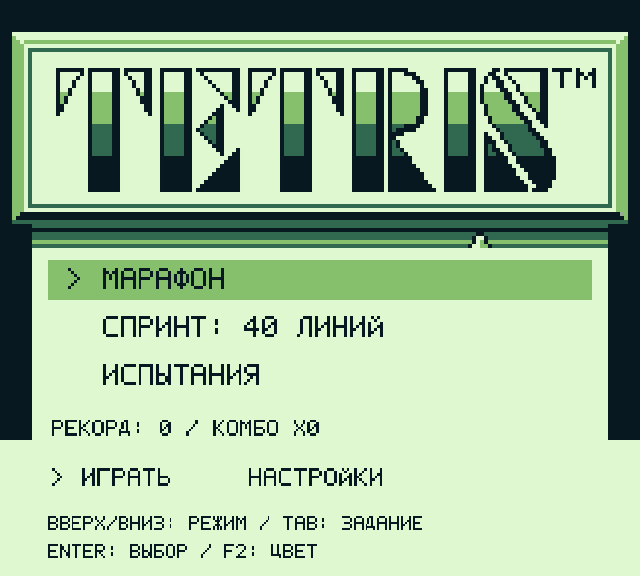
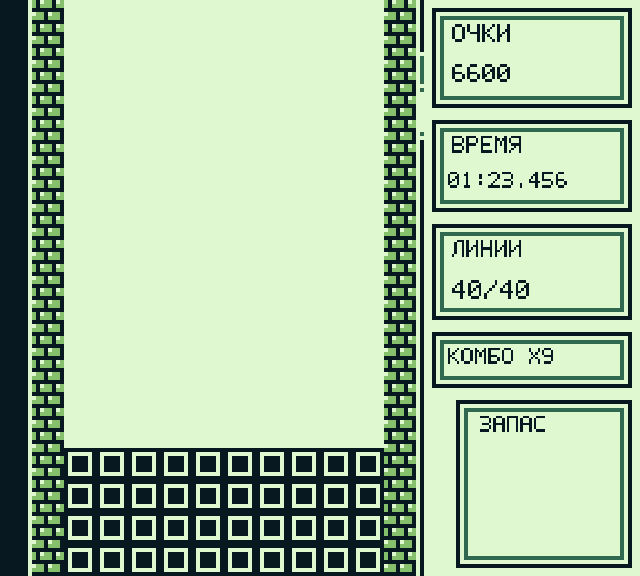
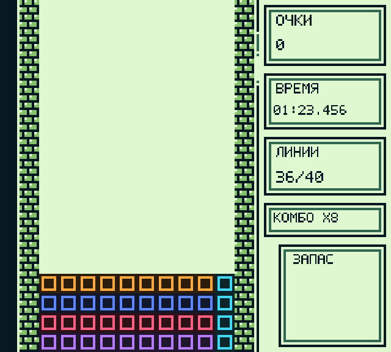

<div align="center">

# 🟩 Game Boy Tetris · RU

**Знакомый тетрис. Пиксели Game Boy. Новые цели.**

Русская версия, спринтом на 40 линий,<br>
испытаниями и комбо.


[Начать играть](#-быстрый-старт) · [Режимы](#-три-способа-играть) · [Управление](#-управление) · [Собрать EXE](#-сборка-из-исходников)



</div>

---

## 🎮 Классика с новыми возможностями

В основе — [GameboyTetris от LordGurr](https://github.com/LordGurr/GameboyTetris). Сохранены логотип, кирпичные рамки, спрайты, музыка и звуки исходной игры. Русский интерфейс использует собственный пиксельный шрифт 5×7.

- **Три режима:** марафон, спринт на 40 линий и испытания.
- **Два вида фигур:** классические зелёные и семь цветов по клавише **F2**.
- **Комбо:** продолжайте цепочку очисток и получайте дополнительные очки.
- **Удобства:** тень места приземления, запас фигуры и задержка фиксации.
- **Личные рекорды:** лучшее время спринта, очки, максимальное комбо и выполненные задания.
- **Один EXE:** движок, ресурсы и среда .NET включены в сборку для Windows x64.

<div align="center">
<table>
  <tr>
    <th>Классический Game Boy</th>
    <th>Цветные фигуры · F2</th>
  </tr>
  <tr>
    <td></td>
    <td></td>
  </tr>
</table>
</div>

## 🚀 Быстрый старт

1. Поместите готовый **`Tetris-GameBoy-RU.exe`** в удобную папку и запустите его.
2. Выберите режим стрелками **↑ / ↓**.
3. Для испытаний выберите задание клавишей **Tab**.
4. Выберите **«Играть»** и нажмите **Enter**.

**Устанавливать .NET отдельно не нужно.** DLL и папка `Content` рядом с EXE также не требуются. При первом запуске встроенные компоненты автоматически извлекаются во временный кэш .NET.

Готовый EXE создаётся командой из раздела [«Сборка из исходников»](#-сборка-из-исходников).

## 🧩 Три способа играть

| Режим | Цель | Особенность |
| :--- | :--- | :--- |
| **Марафон** | Набрать как можно больше очков | Каждые 10 линий повышается уровень и растёт скорость |
| **Спринт · 40 линий** | Очистить не менее 40 линий за минимальное время | Таймер с миллисекундами и личный рекорд |
| **Испытания** | Выполнить выбранное задание | Прогресс выполнения сохраняется между запусками |

### Спринт на 40 линий

Забег заканчивается, когда счётчик достигает **40 линий или больше**. Таймер останавливается при победе. Пауза не входит в результат; при потере фокуса игра автоматически ставится на паузу.

Это локальный тренировочный режим с разрешённой паузой. Нажмите **R**, чтобы сразу начать новый забег.

### Испытания

| Задание | Условие выполнения |
| :--- | :--- |
| **Первые десять** | Очистить 10 линий за одну партию |
| **Тетрис!** | Убрать 4 линии одной фигурой |
| **Держи цепочку** | Достичь комбо **×3** |

Задание переключается клавишей **Tab** в главном меню. Выполненные задания помечаются **`[+]`**.

## 🔥 Как работает комбо

Очищайте хотя бы одну линию каждой следующей фигурой:

```text
1-я очистка → начало цепочки
2-я очистка → комбо ×1
3-я очистка → комбо ×2
4-я очистка → комбо ×3
```

Фигура, которая не очистила ни одной линии, **сбрасывает цепочку**. Число линий за один ход не увеличивает комбо на несколько шагов: важна последовательность очищающих фигур.

За каждую очистку с активным комбо начисляется бонус к обычной награде:

```text
Бонус = 50 × комбо × (уровень + 1)
```

Например, комбо **×3** на уровне **2** приносит **450 дополнительных очков**.

## ⌨️ Управление

### Главное меню

| Клавиши | Действие |
| :--- | :--- |
| **↑ / ↓** | Выбрать режим |
| **Tab** | Переключить задание |
| **← / →** | Выбрать «Играть» или «Настройки» |
| **Enter** | Подтвердить выбор |

### Во время игры

| Клавиши | Действие |
| :--- | :--- |
| **← / →** или **A / D** | Двигать фигуру |
| **↓** или **S** | Ускорить падение |
| **X / Z** | Повернуть фигуру в разные стороны |
| **C** | Отправить фигуру в запас, если он включён |
| **Enter** / **Start** на геймпаде | Пауза / продолжить |
| **R** | Заново начать текущий режим и задание |
| **F2** | Переключить зелёные и цветные фигуры |
| **F11** | Переключить полноэкранный режим |
| **Page Up / Page Down** | Изменить размер окна |
| **Home** | Открыть дополнительное меню оформления |
| **Esc** | Закрыть игру |

**Падение и поворот зависят от настройки управления:**

| Действие | Стандартное управление | Новое управление |
| :--- | :--- | :--- |
| Мгновенное падение | **↑ / W** | **Пробел** |
| Дополнительный поворот | — | **↑ / W** |

После окончания партии: **Enter** — вернуться в меню, **R** — повторить.

<details>
<summary><strong>⚙️ Что можно изменить в настройках</strong></summary>

- Тень фигуры.
- Стандартное или новое управление.
- Запас фигуры.
- Звуковые эффекты.
- Музыку.
- Задержку фиксации.

Стрелки выбирают пункт и значение. **Enter** сохраняет настройки и возвращает в меню. Дополнительные параметры палитры, рамки и масштаба доступны по **Home**.

</details>


</div>
